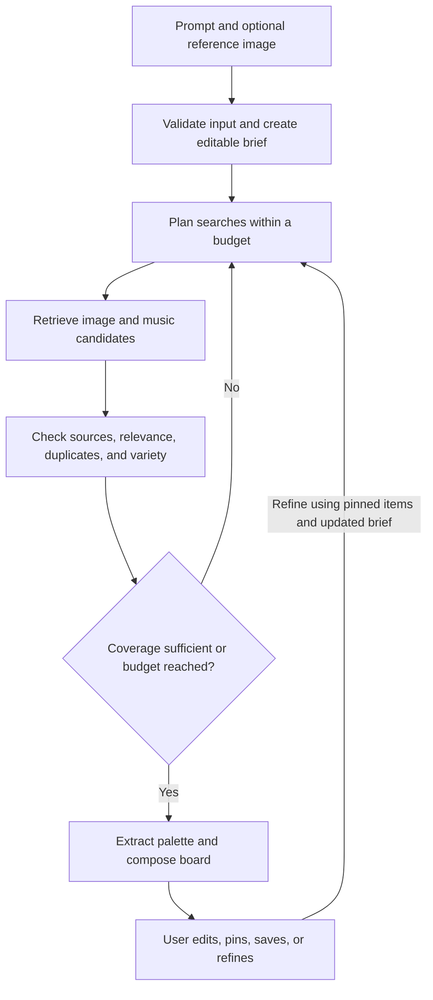

# Scalable — AI Mood Board Studio

Turn a prompt, a reference picture, or both into a researched creative direction: images, color palettes, textures, typography ideas, and music that belong together.

**Status:** The Studio uses HTML/CSS/JavaScript. The ASP.NET Core **GraphQL API and ASP.NET Identity replace Supabase authentication/browser data access**. GraphQL is the API layer: Identity uses SQLite locally or configured PostgreSQL. A Node endpoint can generate AI creative metadata and analyze submitted reference images. Wikimedia Commons supplies bounded, attributed visual references through the ASP.NET API. Boards remain in localStorage; cloud board storage and generated imagery are unimplemented. See the [backend guide](docs/BACKEND.md) and [T003 audit](docs/T003.md).

## Try the frontend

```sh
python3 -m http.server 8080 --directory frontend
```

Open `http://localhost:8080` to use **The Studio**. Explore sample directions, preview reference images, pin images, copy colors, and save/reopen boards in this browser. Use **Customize** for theme, accents, spacing, card edges, typography, board arrangement, canvas background, and reading size.

Manage saved boards through **Saved boards → Delete**, with confirmation before removal. Deleting the open board keeps its current canvas as an unsaved draft.

Boards include **song recommendations and ambient sound directions** as separate content types. Sample songs show real titles/artists, fit explanations, and Spotify catalog-search links. Select songs, sounds, both, or neither before exploring. These are curated examples, not live AI research. **Import audio** adds music links, browser-playable local recordings, or sample references from provider library previews. Local files stay on the device and must be reattached after reloading; saved boards keep metadata only. Spotify, Amazon Music, Apple Music, and SoundCloud connection previews do not sign in or access real accounts. Streaming-service playback is not connected.

Previews: [Studio light](docs/design-previews/studio.png) · [Studio dark](docs/design-previews/studio-dark.png) · [Customization](docs/design-previews/studio-customize.png).

Run the GraphQL/Identity API with .NET 10 using `App__PublicBaseUrl=http://localhost:3000 dotnet run --project Scalable.Api` (POSIX shell); run the frontend/AI process separately with `npm start`, then open `http://localhost:3000`. Node serves `frontend/` at its URL root. The public-base override aligns password-reset links with that layout. Local GraphQL requests use `http://localhost:5078`. Node reads `OPENAI_API_KEY` from its environment or ignored root `.env`; without it AI attempts fall back to samples. See [setup/configuration](docs/BACKEND.md) and [AI behavior](docs/AI-INTEGRATION.md).

**Videos and account screens:** Import YouTube references or local video clips. Load YouTube players on request, play local videos in the browser, and save their metadata for later reattachment. The [login page](frontend/login.html), [create-account page](frontend/signup.html), and [account page](frontend/account.html) use the ASP.NET GraphQL Identity service for permanent accounts, sessions, and password recovery. See the [authentication worklog](docs/AUTH-INTEGRATION.md) and [video/account handoff](docs/VIDEO-ACCOUNT.md).

See [frontend and .NET integration notes](docs/FRONTEND.md) for behavior, limitations, data contracts, and validation.

The [complete frontend documentation](docs/FRONTEND.md) covers every page and implemented workflow, data fields, browser storage, module interfaces, authentication, required API connections, deployment, and browser tests. GitHub Pages serves the frontend only; Wikimedia requests require the hosted ASP.NET API origin.

## GitHub Pages

The repository root redirects visitors to `frontend/login.html`. After human review/merge, publish the intended branch from **Settings → Pages → Deploy from a branch → / (root)** or use the manual workflow. See [deployment instructions](docs/GITHUB-PAGES.md) for the configured Render GraphQL default, endpoint overrides and cross-site cookies. Pages runs neither the .NET API nor Node AI. This audit changes no hosting settings.

## Product vision

Scalable helps people move from a feeling to a clear visual and sonic world. It should work for personal inspiration, brand concepts, interiors, photography, events, and other creative projects.

A user might ask:

> Build a mood board for a quiet coastal café: weathered wood, foggy mornings, muted blue and sand tones, and mellow instrumental music. Use my reference photo, but avoid tropical imagery.

The result is an editable board with a short creative brief, several research-backed image references, a coordinated palette, and music recommendations. Each recommendation explains why it fits and links to its source.

## Core experience

1. **Describe the feeling.** Enter a prompt and optionally upload reference pictures. Add constraints such as intended use, colors to avoid, era, location, or energy level.
2. **Interpret the direction.** AI extracts subjects, composition, colors, materials, cultural references, and mood. The user can correct the resulting creative brief.
3. **Research the direction.** The system searches multiple queries and sources, inspects candidate results, removes duplicates, and ranks references for relevance and variety.
4. **Build the board.** Present images, named colors with HEX values, and music recommendations in a coherent layout. Explain the connection between the elements.
5. **Refine and save.** Pin favorites, remove results, request changes such as “warmer” or “less minimal,” and save the board without losing pinned items.

## What “deep research” means

Research should do more than return the first page of image search results:

- Translate the brief into several related search directions, including visual styles, materials, places, and music characteristics.
- Retrieve candidates through supported search and media APIs, preserving source URLs and available creator and license metadata.
- Check candidates against the prompt and reference pictures; group near-duplicates and balance relevance with variety.
- Refine searches when coverage is weak or results conflict with explicit constraints.
- Explain the selected direction using the sources actually retrieved. Distinguish a source's description from the AI's interpretation.
- Use bounded rounds, time limits, and per-board budgets. Show progress, allow cancellation, and retain useful partial results when a provider fails.

Research depth will grow after the first end-to-end workflow works. Missing evidence or unknown licensing must remain visible; the system must not invent sources or permissions.

## First release scope

### MVP essentials

- Prompt input plus an optional reference image, with file type and size validation.
- An editable structured creative brief.
- One researched direction per board with approximately 8–12 curated images.
- A palette of 5–7 colors, extracted from reference or selected images and adjusted for cohesion.
- Approximately 5 song recommendations, with artist/title, a short fit explanation, and verified provider links, plus separate ambient sound recommendations. Allow songs, sounds, both, or neither.
- Source links and available attribution for every external item; explicit unknown license status where needed.
- A responsive board editor with pin, remove, replace, and refinement actions.
- Account-based private board saving and reopening.
- Research progress, useful empty/error states, and retry support.

These result counts are targets. The app should return fewer credible results when evidence is limited.

### Later releases

- Multiple creative directions from the same prompt.
- Dedicated texture, material, and typography research.
- PNG/PDF exports with attribution and optional share links.
- Playlist creation through an authorized music account.
- Collaborative boards, comments, and version history.
- Brand kits, reusable preferences, and project collections.
- Optional generated imagery, clearly labeled and separate from sourced references.

Music discovery initially means recommendations and outbound links. In-app playback, audio downloads, and playlist writing require separate provider capabilities and permissions.

## Technical approach and remaining architecture

The implemented account service is C# / ASP.NET Core with Hot Chocolate GraphQL and ASP.NET Identity. GraphQL does not replace the underlying SQL database. The Supabase SDK/configuration/dependency is absent. Node hosts a separate OpenAI creative-direction REST endpoint. Full research, cloud boards, and most media integrations remain future work.

| Area               | Proposed starting point                                                        | Purpose                                                                      |
| ------------------ | ------------------------------------------------------------------------------ | ---------------------------------------------------------------------------- |
| Frontend           | HTML, CSS, JavaScript modules                                                  | Prompt entry, uploads, and board editor                                      |
| Backend | .NET 10, Hot Chocolate GraphQL, ASP.NET Identity | Implemented registration/login/session/recovery; future cloud board data |
| AI interpretation | Node/OpenAI Responses API for text creative metadata; image analysis future | Generate title/palette/note/song/sound concepts; no sourced image research |
| Research           | Search and image-provider adapters                                             | Retrieve references with traceable metadata                                  |
| Palette extraction | Image processing and color clustering                                          | Derive actual colors before AI naming and curation                           |
| Music discovery    | Music catalog/search adapter                                                   | Verify tracks and links; add audio-feature matching where supported          |
| Data and accounts | Identity: EF Core SQLite or configured Npgsql/PostgreSQL | Real accounts; boards/profile/preferences still localStorage |
| Background work    | Durable job runner, selected during the spike                                  | Run bounded research jobs with progress, retries, and cancellation           |
| Validation         | Browser automation for the frontend; .NET tests for the backend                | Exercise research logic, integrations, and the main user journey             |

Provider credentials stay on the server. Use model outputs as structured proposals and validate them before storing or rendering them. Treat retrieved pages and uploaded content as data, never as instructions for tools.

### Research pipeline



### Initial data model

- **Board:** owner, title, original prompt, reference uploads, current brief, and timestamps.
- **Board item:** type, position, pinned state, external identifier or stored asset reference, and fit explanation.
- **Source record:** provider, canonical URL, creator, available license information, and retrieval time.
- **Palette:** color values, labels, and provenance linking colors to the images used.
- **Research run:** board, brief snapshot, status, queries, provider results, errors, usage/cost, and cancellation state.

Keep research runs separate from the editable board so retries and refinements do not overwrite user choices. Store external media only when the provider's terms permit it; otherwise retain permitted metadata and links.

## Roadmap

Each milestone ends with a demonstrable result. Sequence is more useful than calendar estimates until the provider spike establishes the main constraints.

### 0. Validate the research approach

- Choose a small evaluation set covering contrasting styles, prompt-only input, image-only input, and combined input.
- Test candidate AI, image-search, and music providers for access, metadata quality, allowed use, latency, and cost.
- Prototype image analysis, palette extraction, and track-link verification.
- Establish initial per-board cost/time budgets and document integration decisions.

**Done when:** A real prompt and a reference image can produce a sourced sample board, and the supported use and limitations of each selected provider are documented.

### 1. Build the application foundation

- Scaffold the web app, development scripts, formatting, type checks, and CI.
- Add authentication, private storage, database migrations, and board ownership rules.
- Implement prompt entry, image upload validation, and brief review.
- Document local setup and required environment-variable names without committing credentials.

**Done when:** A user can sign in, submit a prompt and/or image, review a brief, and reopen the saved draft. Another user cannot read its board or uploads.

### 2. Deliver the first researched board

- Implement provider adapters and a durable research job with visible progress.
- Retrieve and curate images, extract a palette, and resolve real music recommendations.
- Render source links, attribution, explanations, and partial-result states.
- Track run duration, provider usage, and estimated cost.

**Done when:** The complete input-to-board journey works with live providers, contains verified source links, respects configured budgets, and handles a provider failure without losing the draft.

### 3. Make boards useful to edit

- Add pinning, removal, item replacement, and prompt-based refinement.
- Save board layout and selected items across sessions.
- Preserve pinned items during refinement and prevent late job results from overwriting newer user edits.
- Support cancellation and safe retries without duplicating board items.

**Done when:** A user can refine, save, and reopen a board with their choices intact, including after an interrupted research run.

### 4. Improve research quality and prepare a beta

- Add iterative query refinement, better duplicate detection, and diversity controls.
- Evaluate coherence, prompt adherence, reference-image fidelity, source quality, latency, and cost using the evaluation set.
- Add rate limits, upload retention/deletion behavior, accessibility checks, and operational error reporting.
- Test mobile layouts and the end-to-end journey before a small user beta.

**Done when:** The evaluation results are documented, critical flows pass, and beta users can consistently create and refine useful boards within the chosen budgets.

### 5. Expand from observed demand

Prioritize exports, sharing, playlists, typography, collaboration, and generated imagery based on beta feedback. Define acceptance criteria and provider requirements for each before implementation.

## Current validation

Run `dotnet build Scalable.sln`, `dotnet run --project tests/backend/Scalable.Api.Checks.csproj`, the Node checks, and the five browser scripts in [frontend validation](docs/FRONTEND.md#17-validation-and-test-coverage). Browser checks need separately installed Playwright/Chromium; video checks require FFmpeg. There is no npm test script. Backend compilation, image-source checks, the focused demo integration suite, and saved-board checks pass. The older Studio suite has a song-fixture expectation that also fails on unchanged main; the authentication-suite issues recorded in [T003](docs/T003.md) remain outside this cleanup.

## Planned validation for remaining features

- **Unit tests:** Brief validation, palette extraction, ranking, duplicate handling, and research budget limits.
- **Integration tests:** Provider response parsing, source preservation, retry/cancellation behavior, and persistence. Use fixtures for routine CI and explicit live checks for provider verification.
- **End-to-end tests:** Create a board, upload a reference, pin and replace items, refine, save, and reopen. Include access-control and failure paths.
- **Quality review:** Score a fixed evaluation set for creative coherence, constraint adherence, and usefulness. Keep human quality judgments separate from automated correctness checks.

## Constraints and decisions to resolve

- **Media rights:** Finding an image does not grant reuse rights. Attribution, caching, exports, and sharing must follow each source's terms.
- **Music access:** Catalog availability, playback, audio features, and playlist APIs vary by provider and account. The initial integration must support verified discovery links.
- **Upload privacy:** Reference pictures are private by default. Define retention, deletion, signed access, and which providers receive uploads before beta.
- **Research cost:** Fan-out searches and model calls need caps, caching where permitted, and measurable costs.
- **Creative quality:** A coherent board requires curation and user feedback. Search relevance alone is insufficient.

The roadmap describes product targets; accounts and the application scaffold already exist. Next work includes repairing current regressions/deployment gaps, then proving the sourced prompt/image-to-board pipeline and owner-backed cloud persistence.
